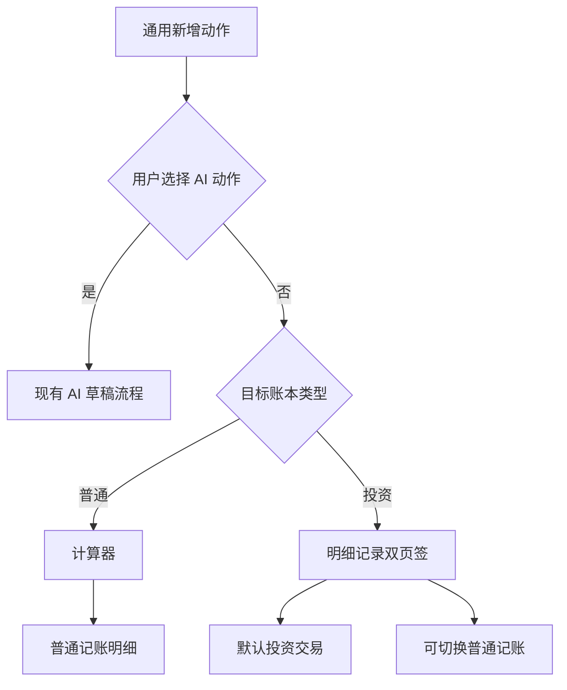

# 投资账本与证券账户交互开发方案

日期：2026-10-30。状态：待实施。配套文件：[开发任务与验收清单](investment-ledger-interaction-acceptance.md)。

本方案将新建账本类型、手动新增交易入口、投资录入页签和证券账户详情作为一组交互调整。普通账本继续使用现有记账流程；投资账本直接进入带“普通记账 / 投资交易”页签的明细页，默认投资交易。证券币种账户直接展示持仓、现金、投资记录及基本信息，减少进入账户后再跳转“证券投资”的步骤。

本次交付仅为方案文件。下文区分用户已确认规则和配套实施建议；任务、拟建 API、数据库版本及验收项均不代表已经实现。

## 已确认规则与实施建议

### 已确认规则

| 事项 | 开发依据 |
| --- | --- |
| 账本类型 | 新建账本时选择“普通账本”或“投资账本”，默认普通账本 |
| 历史兼容 | 所有没有类型字段的历史账本均为普通账本，包括名称叫“投资账本”或已有证券持仓的账本 |
| 普通账本新增 | 保持原来的使用方式，手动新增仍先打开计算器，再进入普通记账明细 |
| 投资账本新增 | 手动新增跳过首次计算器，直接打开明细记录页，顶部可选择普通记账或投资交易，默认投资交易 |
| 判断条件 | 依据持久化的账本类型；不再以“是否存在证券账户”决定全局新增入口 |
| 本次范围 | 整理完整开发方案和文件，暂不修改功能代码或构建应用 |

### 配套实施建议

以下细节用于使上述流程完整，并落实此前证券账户页面合并的讨论：

- 在账本管理中允许显式修改类型。类型只决定默认入口和展示方式，不限制可保存的账户或资产；切换类型不改写历史数据。
- 证券币种账户直接进入证券详情，底部并入基本信息卡；多币种主账户继续先显示汇总和币种子账户。
- 账户内新增优先使用明确的账户上下文；持仓内买卖再预填证券、合约和方向。
- 保留用户已有 AI 快捷记账偏好。账本类型分流用于手动新增，主动选择 AI 的入口继续生成普通记账草稿。
- 普通记账与投资交易分别保留本次编辑期间的草稿；保存只提交当前记录，不自动提交其他页签或账户下的草稿。
- 投资交易复用当前股票、期权和基金流程，不改变其金额、持仓、结算或收益计算。

这些建议不引入新的行情服务、联网授权或后台任务。实施时若需要改变上述业务边界，应先更新本方案中的对应规则。

## 当前实现与差距

源码核对基线为 `main` 的 `1203248`。当前 SQLite 为 v28、完整 JSON 备份为 v15；账本尚无类型字段。实施前应重新核对版本，不能覆盖期间增加的迁移。

| 当前能力 | 源码位置 | 本轮差距 |
| --- | --- | --- |
| 账本模型、创建与管理 | `lib/app/models/ledger_book.dart`、`lib/pages/ledger_books_page.dart`、`lib/pages/sheets.dart` | 只有名称、本位币等字段，没有普通/投资类型 |
| 首页手动新增 | `lib/pages/shell.dart` 的 `_startQuickEntry` | 按 AI 偏好分流后，手动固定为计算器到 `EntryDetailPage` |
| 交易列表新增 | `lib/pages/transactions_pages.dart` 的 `_startQuickEntry` | 重复实现计算器路径，需要共享账本类型判断 |
| Android 快捷新增 | `shell.dart` 的 `_openQuickEntryFromPlatform` | 最终调用首页新增，应沿用同一规则 |
| 普通账户内新增 | `lib/pages/account_detail_page.dart` 的 `_startEntryForAccount` | 计算器后带当前账户进入普通记账 |
| 账户详情导航 | `assets_pages.dart`、`account_group_pages.dart`、`credit_account_detail_page.dart` | 实际币种账户先进入通用账户详情，再点“证券投资” |
| 证券详情 | `lib/pages/investment_page.dart` 的 `InvestmentPage` | 已有现金、持仓、投资事件、行情与历史；缺完整基本信息和普通资金流水整合 |
| 股票、期权、基金编辑 | `StockEditorPage`、`OptionEditorPage`、`FundEntryPage` | 独立页面需复用表单、管理草稿，尚未统一接入离页保护 |
| 普通记账离页保护 | `EntryDetailPage`、`UnsavedChangesGuard` | 已有能力，需要扩展到双页签整体编辑状态 |

`AccountType.investment` 的证券能力只表示“可以启用”，当前是否已启用以 `controller.investmentFor(accountId) != null` 为准。空持仓或已经清仓的投资组合仍属于已启用证券账户。不能按账户名称、非零持仓或行情开关判断，也不能把历史定存、泛理财账户批量初始化为证券账户。

## 账本类型与管理流程

### 新建账本

扩展现有 `showLedgerBookEditorSheet`，在同一表单收集名称、账本类型和本位币。类型使用现有短单选组件，默认“普通账本”，旁边说明入口差异：普通账本先输入金额；投资账本直接录入投资交易，也可切换普通记账。

选择类型、本位币及取消均不落库；保存成功后才关闭并切换到新账本。创建失败保留草稿、显示既有轻提示，不出现“页面已经进入新账本但数据库未保存”的状态。新建投资账本不自动创建证券账户、不生成期初持仓，也不打开行情联网。

### 修改账本类型

账本列表显示类型，在现有更多菜单增加“账本类型”。编辑说明采用“仅改变新增记录的默认入口，已有账户和交易保留”。此操作可逆，沿用普通编辑保存/取消，不增加破坏性确认。

普通改投资后，下次手动新增使用页签页；投资改普通后，下次手动新增恢复计算器。当前已打开的草稿不随外部类型修改强制切页。普通账本内已有证券账户、投资事件和账户内操作入口继续可访问。

类型与本位币相互独立：更改类型不触发币种重解释、换汇、预算重算或资产转换；已有财务数据后的币种限制保持原样。

## 新增入口规则

### 路由优先级

入口按“明确的业务上下文 → 用户主动选择的 AI 动作 → 手动新增的账本类型”处理。编辑已有记录和处理外部草稿固定原业务类型，不参与普通/投资转换。

| 入口 | 普通账本 | 投资账本 |
| --- | --- | --- |
| 首页手动“＋” | 现有计算器 → 普通记账明细 | 双页签明细，默认投资交易 |
| 普通交易列表手动新增 | 保留现有路径与筛选/默认值 | 复用同一双页签入口，默认投资交易 |
| Android 通用快速记账入口 | 沿用首页动作偏好与普通路径 | 沿用首页动作偏好；手动动作进入投资页签 |
| 用户主动选择 AI 或长按 AI | 沿用原有 AI 流程 | 沿用原有 AI 流程，结果仍为待确认草稿 |
| 普通实际账户内新增 | 当前账户 → 计算器 → 普通记账 | 同左，明确账户上下文优先 |
| 已启用证券的币种账户内“新增交易” | 投资录入并预选当前账户 | 同左 |
| 持仓内买入、卖出或专属操作 | 固定投资业务，预填账户、证券及方向 | 同左 |
| 多币种主账户顶部“＋” | 新增币种子账户 | 保持新增币种子账户 |
| 新建账户、金额修改、预算等“＋”或金额输入 | 保持其原有用途 | 保持其原有用途 |

“普通账本保持原使用方式”约束全局手动记账入口；证券账户内部的专属投资操作始终可用。父账户不是真实持仓账户，父账户若另设“新增投资交易”，必须先选具体币种子账户。

Shell 保留手势与 `FabActionMode` 判断；公共手动入口统一解析账本类型，避免复制判断。Android 小组件若已指定目标账本，应先解析该目标，不能误用界面当时显示的其他账本。AI 复核、自动采集、退款、导入、周期记账和现有交易编辑保留各自入口。



### 默认投资账户

投资录入只接受目标账本内的真实币种账户，必须具备证券能力且已初始化投资组合。显示“主账户名 · 币种”，例如“投资账户二 · CNY”；保留区分同币种不同主账户所需的名称。

有明确账户上下文时预填该账户；无上下文时，若当前账本的默认记账账户也是合格证券账户则采用。否则只有一个合格账户时可直接选中，多个时要求选择。没有合格账户时显示“新建证券账户”或“初始化现有账户”，不回退到首个普通账户或“无账户”。首版不新增跨会话的最近投资账户偏好。

## 明细记录页与草稿

### 页面结构

投资账本的手动新增直接展示实际表单，不再增加一个只有两个入口按钮的过渡页：

```text
返回                 新增记录                  账本上下文
              普通记账  |  投资交易

普通记账                         投资交易
金额 / 支出收入转账              证券账户 / 业务品种
分类 / 账户 / 日期               股票、期权或基金对应字段
备注 / 标签 / 附件               数量、价格、费用及业务预览

                     保存当前记录
```

顶部两页签使用 `VeriSegmentedControl`，高频切换时持续可见。业务品种使用现有受控选择器，避免再叠一排与主模式竞争的页签。固定保存区随当前表单展示，保存按钮在键盘弹起后仍可达；新建页的统一底部保存安排属于本轮交互调整，业务校验和确认步骤仍复用原流程。

普通记账页签允许以未填金额进入，金额为零或不合法时禁用保存；点金额仍调用现有数字键盘。跳过的是“进入明细前的首次计算器”，不是删除计算器或改变所有金额输入。

新建双页签仅用于手动新增。已有普通交易、投资事件、基金申请、AI/导入/采集草稿进入其专用编辑或复核流程，不提供将一条记录跨领域转换的页签。

### 草稿与退出规则

1. 页签切换只更新页面状态，普通记账和投资交易各自保留输入，不写 Controller、SQLite 或 KV。
2. 投资草稿按实际账户、业务品种及操作隔离，因此整个编辑会话可能不止两份草稿。切换账户或币种时，不把 USD 数字直接解释成 CNY；账户、证券、合约、费用及预览要重新校验。
3. 切换目标账本不能静默迁移整份投资草稿。普通记账保留已有显式换账本规则；新增投资流程首版绑定进入时的目标账本，退出后重新进入才能换账本。
4. 保存只提交当前记录。使用稳定事件 ID、防重复点击及既有原子命令，失败时保留当前所有草稿并反馈；成功后更新该草稿的已保存基线，切回时不能再次新增同一记录。
5. 当前保存成功且所有其他草稿均无改动时可正常退出；另一页签或隐藏的账户/品种草稿仍有未保存内容时留在编辑页，提示当前记录已保存，允许继续处理剩余草稿。
6. 整页返回检查全部草稿，包括未显示的账户和品种，复用 `UnsavedChangesGuard` / `EditorExitController`。只有当前草稿有改动时沿用保存/不保存/取消；多个草稿有改动时明确“保存当前”“丢弃全部并退出”“取消”，保存当前后若仍有未保存草稿则不退出，不自动生成其他交易。
7. Header 返回、系统返回、预测性返回使用同一规则。进程被系统终止后首版不恢复未提交草稿，不增加隐式草稿持久化。

退出保护若需支持“保存成功但仍有其他草稿”，应参数化扩展现有公共组件的结果语义；不得复制内联确认框，或将“保存成功但留页”伪装成持久化失败。当前草稿未修改而其他草稿有改动时，不提供无效的“保存当前”，只允许返回处理或明确丢弃后退出。

### 复用三类投资表单

| 品种 | 复用入口与命令 | 必须保留的行为 |
| --- | --- | --- |
| 股票 | `investment_page.dart` 的 `StockEditorPage`；`saveStockEvent`、`transferStock` | 份额、成交价、费用、买卖及持仓转移校验；不以总金额猜测股数 |
| 期权 | `option_editor_page.dart` 的 `OptionEditorPage`；`saveOptionSpecification`、`saveOptionEvent` | 合约规格、乘数、开平仓、冻结预览、交割校验及再次确认 |
| 基金 | `fund_entry_page.dart` 的 `FundEntryPage`；`veri_fin_controller_funds.dart` 公共命令 | 按金额申购、确认、取消退款和已有份额基准；独立付款/起算事实、净在途、实际数量和总成本 |

将表单内容及草稿控制从原页面壳中提取，原独立编辑入口和新页签复用同一实现。避免把完整 `Scaffold` 嵌入另一页的 `Scaffold`，也不复制三套计算和保存逻辑。期权结算、持仓转移、基金订单确认等专属操作保留专属流程，不全部塞入通用新建表单。

基金必须按真实品种分发，不作为普通股票编辑；不得更改成交净值日归属、历史基准、同刻现金边界或未实现盈亏计算。详细业务继续以[基金录入与结算](fund-amount-settlement.md)为准。

## 证券账户详情与基本信息

### 统一进入规则

集中一个账户详情导航入口，供资产列表、分组列表及父账户子账户列表调用：多币种父账户进入现有父账户汇总；有投资组合的实际账户进入证券详情；其余进入现有普通/信用账户详情。判断与账本类型独立，普通账本里的证券账户同样能直达持仓。

拟新增的 `openAccountDetails(context: ..., accountId: ...)` 只是导航建议名，不表示当前已有此 helper。它只读取公共 Controller API，不替 UI 访问数据库或推导现金。

### 证券页信息顺序

| 区域 | 展示与操作 |
| --- | --- |
| Header | 账户名、实际币种及主账户上下文；保留返回与必要设置/行情入口 |
| 资产概览 | 参考净值、现金、多头持仓、空头义务、冻结/可用现金、已实现及未实现盈亏等现有指标 |
| 持仓与在途 | 股票、期权、基金持仓及已有基金在途/订单信息，保留每个品种的专属操作 |
| 投资记录 | 投资事件，新增、查看、修改、删除继续走对应业务校验 |
| 资金流水 | 同账户普通入金、出金、转账等 `LedgerEntry`，可进入完整流水；不复制投资现金腿 |
| 历史与参考信息 | 保留已有历史估值、基金参考历史、行情等入口，按现有数据条件展示 |
| 基本信息 | 只读展示账户资料，提供独立“编辑资料”入口 |

基本信息包括名称、账户类型、币种、所属主账户、分组、备注、计入资产、隐藏状态、默认账户状态和现有提醒入口；某类账户不适用的字段不显示。编辑复用抽取的账户资料表单，保存/取消独立于持仓页。不能复制整个通用账户详情，保留两套资料保存逻辑。

证券页的现金核对沿用现金锚点，明确“现金”与“参考净值”。不把净值放入普通余额修改框，不伪造收支补齐持仓市值。普通资金流水、投资事件可以互相导航，但不能重复记账或混成无类型的交易列表。

### 普通账户如何展示

| 账户 | 继续使用的页面内容 |
| --- | --- |
| 现金、支付、普通银行卡 | 当前余额、余额趋势、普通最近交易、账户基本信息 |
| 普通多币种银行主账户 | 展示币种估值、币种子账户、合并普通流水和公共资料 |
| 证券主账户 | 主账户汇总、各币种子账户与公共资料；不默认代选币种 |
| 历史未初始化证券的投资类账户 | 保留普通余额管理及显式初始化入口，不自动转换原余额/持仓 |
| 信用账户及信用主账户 | 继续显示欠款、额度、账单和还款等信用专属内容 |

普通页面不出现证券空持仓、行情或期权等无关区域；不因账本类型是投资而让其所有账户使用证券页面。

### 新建与旧账户初始化

从“新建证券账户”进入时，账户基本信息与期初证券现金在创建流程内收集，初始持仓可为空。正常完成后即可进入证券页，不需要用户再次找“启用”按钮。仅在用户明确新建零现金账户时采用零，不以原通用余额默认冒充已核对期初现金。

创建新主账户/币种账户并初始化投资组合需要作为一个可等待、可回滚的 Controller 操作。当前 `addAccountDraft` 与 `enableInvestment` 是分开的命令，不能在 UI 顺序调用后假设整体原子成功；实施时扩展现有仓储事务边界，并为内存和 SQLite 仓储提供同一契约。已有主账户下创建币种账户失败不得删除原主账户，重试也不得重复创建同币种子账户。

历史账户只通过用户明确初始化，复用现有现金与期初持仓校验；取消不改变账户数据。新建普通账户、新增零余额币种子账户保留各自现有语义，不借此批量初始化证券。

## 数据模型与持久化

### 拟新增字段

| 层级 | 计划结构 | 规则 |
| --- | --- | --- |
| Dart | `LedgerBookType.normal / investment`；`LedgerBook.bookType` | 构造默认 normal，`copyWith` 保留，展示名通过 `label(AppLocalizations)` |
| JSON | `ledgerBooks[].bookType` | 保存稳定字符串 `normal` 或 `investment`，不使用中文展示名作存储值 |
| SQLite | `ledger_books.book_type TEXT NOT NULL DEFAULT 'normal'` | 每本独立存储，读取不依赖当前持仓或名称 |

账本类型属于账本数据，进入 SQLite 和完整备份，不存为设备全局偏好。新增记录页的临时模式和草稿只留编辑会话内，不写入账本类型。

### 迁移与备份兼容

按当前基线预计 SQLite v28 → v29，JSON v15 → v16。实施时若版本已被其他功能使用，向后顺延，不修改已发布的历史迁移。

1. 同步 `AppDatabase.schemaVersion`、`_schemaCurrent` 和新的迁移段，为所有旧行填入 normal；更新 `_bookToRow` / `_bookFromRow`。
2. 同步 `LedgerBook.toJson` / `fromJson`、导出版本和导入上限，继续读取 v1–v15；旧备份缺类型字段一律 normal，不按名字推断。
3. 新版本显式非法类型应在导入预览阶段拒绝，原账目零变化；不将拼写错误或未知未来类型静默解释为投资。数据库非法值按现有损坏数据处理路径提供可见反馈，不静默重写。
4. 备份 dry-run 使用相同解析/校验，预览取消不改 SQLite、内存、当前账本或设备偏好。字节编解码仍只归 `BackupService`。
5. 新版样例备份显式标明普通与投资类型。重新编制的投资样例可以明确设 investment；原始 v15 备份导入仍必须 normal，两者不能混为自动迁移规则。
6. 默认账本和重置/初始化的默认值为 normal。语言切换不改账本类型；删除账本依旧按现有整替事务清理，不保留悬空引用。
7. 新版备份由支持新版本的应用恢复；旧版应用不能被承诺可读取并完整保留新字段。不提供数据库降级，不要求清除应用数据。

### Controller 命令与失败处理

账本创建现有 `addLedgerBook` 为先改内存、再追踪异步持久化。本轮应使创建与改类型入口可等待：准备候选状态，落库成功后提交内存，失败返回明确结果并留在编辑页。可采用返回成功标志或创建实体的 `Future`，具体签名应与现有调用点一起迁移，避免一部分入口继续忽略保存结果。

账本创建与当前账本 KV 指针不是同一存储事务：先保存账本，再保存/切换指针；若指针失败，已创建账本保留可选，明确反馈“账本已创建，切换失败”，不能重试创建出第二本。修改类型只保存该本账本数据，不扩大为无关整库重写。

保存前再次检查目标账本、账户、币种、投资组合及事件是否仍有效。删除或切换导致上下文失效时保留草稿并要求处理，不回退首账户。结构化日志和方法注释使用中文，日志不输出完整账目、备注或凭证。

## 代码与组件改动范围

| 模块 | 计划修改 |
| --- | --- |
| `lib/app/models/ledger_book.dart` | 类型枚举、字段、复制及 JSON 映射 |
| `lib/data/app_database.dart`、`ledger_repository.dart` | 新迁移、建表及行映射；证券账户创建所需的聚合事务契约 |
| `veri_fin_controller_ops.dart`、`veri_fin_controller_state.dart`、`demo_data.dart` | 类型创建/修改/载入/备份/初始化，保存结果与账本隔离 |
| `lib/pages/ledger_books_page.dart`、`sheets.dart` | 创建类型选择、显示及显式修改 |
| `shell.dart`、`transactions_pages.dart` | 将手动新增分流委托给公共入口，保留 AI 与 Android 调用链 |
| 拟新增 `transaction_entry_page.dart` 与共享入口模块 | 双页签外壳、目标账本上下文、独立草稿及统一离页保护；名称在实现时确定 |
| `entry_detail_page.dart`、`investment_page.dart`、`option_editor_page.dart`、`fund_entry_page.dart` | 抽取可复用表单及草稿；原独立编辑继续可用 |
| `account_detail_page.dart` 与账户导航调用点 | 资料编辑复用、证券页直达、基本信息和资金流水入口 |
| `lib/l10n/app_zh.arb`、`app_en.arb` | 类型、页签、空态、退出和失败反馈等中英文文案，使用 gen-l10n 生成 |
| `test/`、样例备份及文档 | 迁移/往返/仓储/持久化/页面/导航/金额保护及 Android 手动验收 |

复用 `VeriHeader`、`VeriPage`、`VeriCard`、`SettingsRow`、`VeriSegmentedControl`、`SummaryMetric`、`InvestmentSection`、`InvestmentInputField`、`InvestmentHint`、`InvestmentQuoteDetails`、既有账户/币种选择器与根级反馈。短静态单选用 `VeriAnchoredChoice`，动态证券账户用筛选后的领域选择器。先查[组件清单](components.md)，不新引入状态库、UI 库或依赖。

页面采用不透明实色、统一设计令牌和 16dp 内容边距；金额及来源时间完整换行。覆盖 393×852、360dp、系统大字号、浅深色与键盘遮挡；不更改 `UNIFIED_DESIGN_PREVIEW` 默认值，不恢复玻璃材质。

## 分阶段开发与交付

| 阶段 | 任务 | 完成门槛 |
| --- | --- | --- |
| P1 数据基础 | 账本类型、SQLite 迁移、备份和初始化兼容、可靠保存 API | 历史全部普通；新类型往返及失败恢复通过；金额和实体引用不变 |
| P2 账本管理 | 新建选择、列表标识、修改类型 | 默认/选择/保存/取消/失败/冷启动行为可验收 |
| P3 录入复用与草稿 | 普通、股票、期权、基金表单复用，双页签及离页保护 | 原专用编辑保持有效；切换零写入，保存当前且重试不重复 |
| P4 全局新增路由 | 首页、交易列表、Android 通用新增接入共享入口，保留 AI 偏好 | 普通原路径、投资默认页签、多账本隔离均通过；不修改通用计算器 |
| P5 证券账户整合 | 共享详情导航、基本信息、资金流水、新建证券账户初始化 | 父子账户路径清晰；所有原指标/操作保留；创建事务失败无半套数据 |
| P6 完整验证与文档 | 迁移、备份、普通账户、投资三品种及 Android 手动验证 | 配套清单通过，未通过项有明确原因和处理记录，不以模拟数据宣称行情覆盖 |

依赖关系为 P1 → P2，P1 → P3 → P4；P5 可在 P1 后并行整理资料组件，但导航切换须在页面整合完成后启用。各阶段形成相对独立提交；功能不完整的中间状态不得替换正式入口。

本轮不估算未经确认的人日。每阶段以可操作结果和验证证据完成，而不是以文件数量或代码量完成。

## 验证与实施边界

详细测试任务、场景与证据要求见[开发任务与验收清单](investment-ledger-interaction-acceptance.md)。最低验证包括类型四向映射、全部历史 schema 升级、两种仓储契约、进程重建、旧/新备份、真实样例导入、双页签草稿和保存失败、股票/期权/基金金额不变，以及 Android 快捷入口和系统返回。

实施阶段运行格式检查、`flutter analyze`、相关测试和全量 `flutter test`；先记录当时基线，不能沿用历史通过数或失败数。Android 安装和运行采用用户授权的手动验证，不启动自动编译或监听。现有应用数据先备份，隔离包验证不清数据；正式安装包继续由 CI 生成，推送/发版另需用户明确授权。

本轮不扩展真实券商下单、行情来源覆盖、期权链或持续联网报价；不删除既有基金能力；不改变行情准入、手动刷新规则及逐账户自动冷却。更改账本类型、打开证券页或保存资料均不得开启联网，退后台或锁屏仍按原会话规则停止后续自动请求。

## 完成标准与文档同步

交付时必须同时满足：普通账本全局记账保持原体验；投资账本手动新增直达默认投资页签；证券账户资料和业务入口完整；旧账本/旧备份默认普通；账本切换、失败与重启无数据损失或跨账本引用；股票、期权、基金以及普通账户均有相应验收证据。

实现时同步 `README.md`、[架构](architecture.md)、[组件](components.md)、[技术决策与备份范围](tech-decisions.md)、[设计规范](../design-system.md)、[产品说明](../product.md)、[总验收清单](../acceptance-checklist.md)、[模板说明](sample-investment-template.md)和 `CHANGELOG.md` 的 Unreleased。检查 `AGENTS.md` / `CLAUDE.md` 是否需要调整导航说明，不另维护一套规范。

本次只新增方案及索引，不把待实施内容改写为上述文档中的已实现能力，也不新增功能 CHANGELOG。
